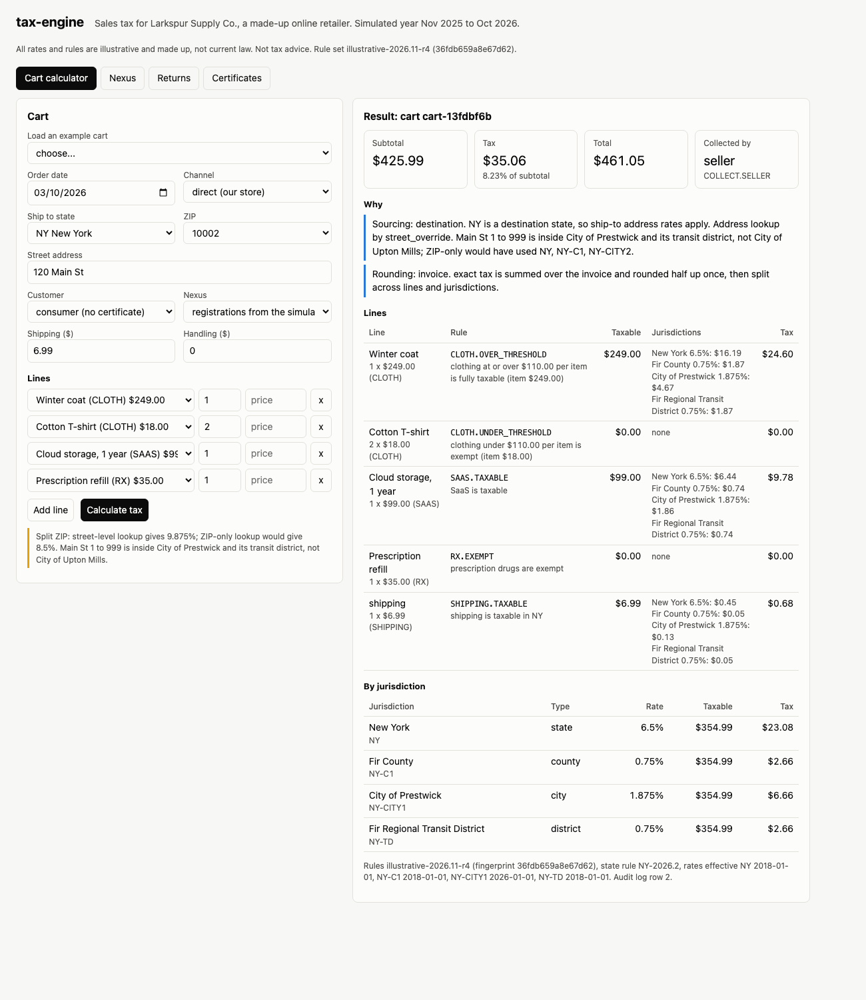
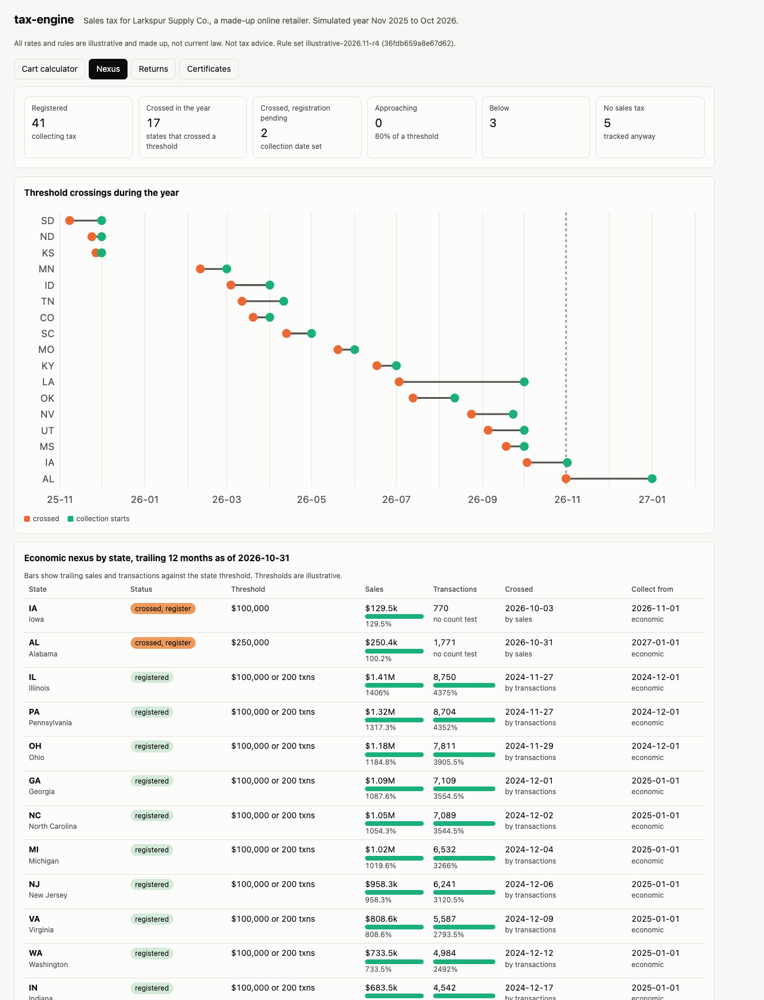
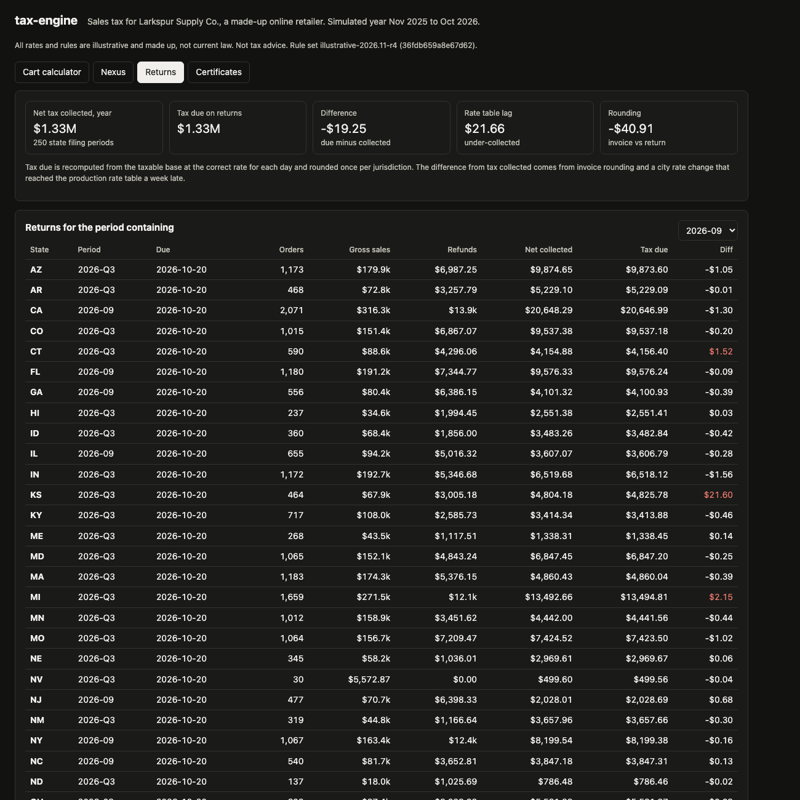
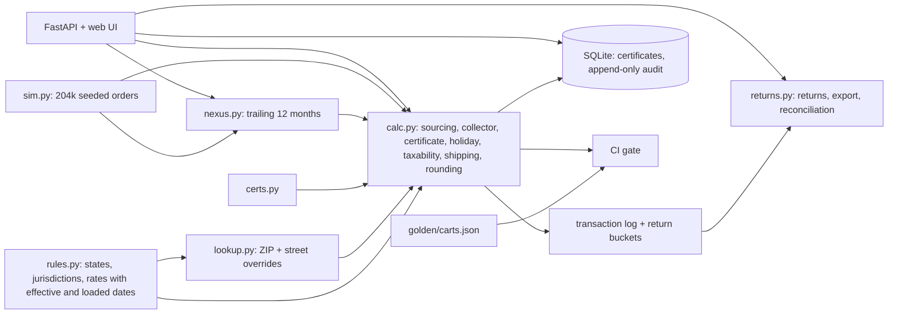

# tax-engine

A US sales tax calculation and compliance engine for Larkspur Supply Co., a made-up online retailer that sells physical goods, digital goods, and services into every state. It looks up jurisdictions by address (with street-level overrides for ZIPs that cross a city line), applies product taxability, exemption certificates, tax holidays, sourcing and marketplace rules, rounds at line or invoice level, and explains every cent. Around it sit economic nexus tracking, returns preparation with refunds netted, and a reconciliation of tax collected against tax due, all driven by a seeded year of about 200,000 orders.

**Educational, not tax advice.** Every rate, threshold, holiday and taxability rule in this repo is illustrative and made up. State rates are generated from the state code, local jurisdictions are synthetic, and rule assignments were chosen to give variety. None of it is current law.



| Result (seed 20261, simulated Nov 2025 to Oct 2026) | Number |
|---|---|
| Tests | 102 passing in about 4 seconds |
| Golden carts | 60 carts, exact expected tax per line, checked in CI |
| Orders simulated | 204,110 (164,674 seller collected, 23,789 marketplace, 10,304 before registration, 5,343 into no tax states) |
| Sales | $30.7M; tax collected $1,374,730 (before refunds) |
| Jurisdictions | 50 states and DC, 238 local jurisdictions (counties, cities, transit and stadium districts), 68 split ZIP street ranges |
| Nexus | 17 states crossed a threshold during the year, 2 crossed and waiting for their registration date, 3 still below |
| Returns | 250 state filing periods (monthly or quarterly by state), refunds netted in the month paid |
| Reconciliation | net collected $1,328,248.45 vs due $1,328,229.20: rate table lag +$21.66, rounding -$40.91 |
| ZIP-only lookup | on the 4,808 seller orders to override streets, ZIP-only lookup would have under-collected $6,247 of $44,918 (13.9%) |

## Why

Sales tax looks like `price x rate` until you ship into 46 taxing states. The rate depends on the street, not the ZIP. Whether an item is taxable depends on the state (a $90 sweater is exempt in one state and taxable next door), and sometimes on the price of each item. Shipping is taxable in some states, exempt in others, and taxable only in proportion to the taxable items in a third. A marketplace sale is the marketplace's problem in most states. A customer's resale certificate exempts the sale only if it is valid, in date, covers the state, and the state accepts that type. You only collect where you have nexus, nexus arrives on a date nobody announces, and once it arrives you file returns that have to agree with what your invoices charged. Getting any of this wrong is either an under-collection the company pays out of pocket or an over-collection from customers.

| Problem | How it is handled | Where |
|---|---|---|
| ZIP codes are not tax boundaries | ZIP table plus a street range override table; the result says which one decided and what ZIP-only would have used | `lookup.py` |
| Taxability differs by state | Rules as data per state and product tax code: clothing (exempt, per item threshold, or tax only the excess), groceries (exempt, reduced state rate, taxable), digital, SaaS (taxable, exempt, 80% base, reduced rate), installation, shipping and handling | `rules.py`, `calc.py` |
| Exemptions | Certificates per customer with states, issue and expiry dates, validation status, and state acceptance of the type | `certs.py` |
| Tax holidays | Date windows, categories, per item caps, state only or state and local | `rules.py`, `calc.py` |
| Rounding | Integer math in 1e-8 cent units; line or invoice rounding by state; cents allocated back to lines and jurisdictions by largest remainder so they always sum | `calc.py` |
| Sourcing | Destination by default; origin states use the warehouse address for in-state shipments (TX always, PA once its warehouse opens on 2026-05-01) | `calc.py` |
| Marketplace facilitators | Marketplace collects from each state's facilitator date (MO starts 2026-01-01, so earlier marketplace sales are the seller's) | `calc.py` |
| Nexus | Trailing 365 day sales and transactions per state, "or" and "and" thresholds, marketplace sales counted or not, alerts at 80% and 100%, registration date by state rule, physical nexus from warehouses | `nexus.py` |
| Returns | Liability by state, period and jurisdiction from the transaction log; refunds netted; CSV export per state | `returns.py` |
| Reconciliation | Tax due recomputed at the correct rate and rounded once per jurisdiction; the difference split into rate table lag and rounding | `returns.py` |
| Audit | Every API calculation is written to an append-only table (triggers block UPDATE and DELETE) with the rule set version, rule fingerprint, state rule version and the effective date of every rate used | `store.py` |
| Rule changes moving money | 60 golden carts with exact expected tax; CI fails on a one cent difference | `golden.py`, `golden/carts.json` |

## Worked example: one cart

A cart shipped to 120 Main St, ZIP 10002, New York, on 2026-03-10. Output of `taxengine explain cart.json`:

```
cart README-1 on 2026-03-10 to NY, channel direct, collector: seller
  sourcing: destination (NY is a destination state, so ship-to address rates apply); lookup by street_override
    street override: Main St 1 to 999 is inside City of Prestwick and its transit district, not City of Upton Mills; ZIP-only would have used NY, NY-C1, NY-CITY2
  jurisdictions: New York 6.5%, Fir County 0.75%, City of Prestwick 1.875%, Fir Regional Transit District 0.75%
  L1       Winter coat                    1 x $  249.00  CLOTH.OVER_THRESHOLD   taxable $  249.00  tax $ 24.60
           clothing at or over $110.00 per item is fully taxable (item $249.00)
  L2       Cotton T-shirt                 2 x $   18.00  CLOTH.UNDER_THRESHOLD  taxable $    0.00  tax $  0.00
           clothing under $110.00 per item is exempt (item $18.00)
  L3       Cloud storage, 1 year          1 x $   99.00  SAAS.TAXABLE           taxable $   99.00  tax $  9.78
           SaaS is taxable
  L4       Prescription refill            1 x $   35.00  RX.EXEMPT              taxable $    0.00  tax $  0.00
           prescription drugs are exempt
  SHIPPING shipping                       1 x $    6.99  SHIPPING.TAXABLE       taxable $    6.99  tax $  0.68
           shipping is taxable in NY
  rounding: invoice (exact tax is summed over the invoice and rounded half up once, then split across lines and jurisdictions)
  by jurisdiction: NY $23.08, NY-C1 $2.66, NY-CITY1 $6.66, NY-TD $2.66
  subtotal $425.99  tax $35.06  total $461.05
  rules: illustrative-2026.11-r4 (36fdb659a8e67d62), NY-2026.2
```

The taxable base is $354.99 (coat, SaaS, shipping). At the street level the combined rate is 9.875%: 354.99 x 0.09875 = $35.055 exactly, rounded half up once for the invoice to $35.06. A ZIP-only lookup puts this address in the City of Upton Mills (8.5% combined) and would charge $30.17, $4.89 short. The shirts are $18 each, under the $110 per item threshold, so they are exempt even though the line is $36. In Massachusetts (illustrative rule: only the part of an item over $175 is taxed) the same coat would be taxed on $74.

## Nexus timeline

The retailer started the year registered in 26 states (TX by its warehouse, the rest by economic nexus in the prior year). It launched marketing in 12 more states on fixed dates, and growth carried smaller states over their thresholds. Each row is the day the trailing 12 months first met the threshold, and the day collection starts under that state's rule (first of next month, 30 days later, or next quarter).

| Crossed | State | By | Threshold (illustrative) | Collect from |
|---|---|---|---|---|
| 2025-11-08 | SD | transactions | $100,000 or 200 | 2025-12-01 |
| 2025-11-24 | ND | transactions | $100,000 or 200 | 2025-12-01 |
| 2025-11-27 | KS | sales | $100,000 | 2025-12-01 |
| 2026-02-10 | MN | transactions | $100,000 or 200 | 2026-03-01 |
| 2026-03-04 | ID | sales | $100,000 | 2026-04-01 |
| 2026-03-12 | TN | transactions | $100,000 or 200 | 2026-04-11 (30 days) |
| 2026-03-20 | CO | sales | $100,000 | 2026-04-01 |
| 2026-04-13 | SC | transactions | $100,000 or 200 | 2026-05-01 |
| 2026-05-20 | MO | sales | $100,000 | 2026-06-01 |
| 2026-06-17 | KY | transactions | $100,000 or 200 | 2026-07-01 |
| 2026-07-03 | LA | sales | $100,000 | 2026-10-01 (next quarter) |
| 2026-07-13 | OK | transactions | $100,000 or 200 | 2026-08-12 (30 days) |
| 2026-08-24 | NV | transactions | $100,000 or 200 | 2026-09-23 (30 days) |
| 2026-09-05 | UT | transactions | $100,000 or 200 | 2026-10-01 |
| 2026-09-18 | MS | sales | $250,000 | 2026-10-01 |
| 2026-10-03 | IA | sales | $100,000 | 2026-11-01 (pending at year end) |
| 2026-10-31 | AL | sales | $250,000 | 2027-01-01 (pending at year end) |

DC (71% of $100,000), VT (65%) and WY (52%) are still below. Delaware, Alaska, Montana, New Hampshire and Oregon have no sales tax here and are tracked anyway. 10,304 orders ($1.62M) shipped into states before their collection date and carry no tax, which is correct under these rules but is the number a finance team watches.



## Returns and reconciliation

Each state files monthly or quarterly. A return is built from the transaction log: gross sales, refunds (netted in the month they were paid, using the tax actually collected on the refunded lines), taxable sales, and tax per jurisdiction. Tax due is recomputed from the taxable base at the correct rate for each day and rounded once per jurisdiction and period. Over the year:

- **Rate table lag: +$21.66.** One illustrative city rate change (KS-CITY1, +1.00% on 2026-07-01) reached the production rate table on 2026-07-08. Invoices that week used the old rate. The reconciliation finds it in KS 2026-Q3 and nowhere else.
- **Rounding: -$40.91.** Invoices round per line (or per invoice) and the return rounds once. The difference is not random noise: the same prices repeat, so each SKU and shipping fee carries the same fraction of a cent every time. Michigan 2026-Q3 alone is +$2.15 over 1,659 orders.



## Architecture



The simulation runs in about 17 seconds and is cached under `data/cache` keyed by seed, scale, the rule fingerprint and the source of the modules it depends on, so the API starts in about a second after the first run. The Docker image runs it at build time.

## How to run

```bash
cd tax-engine
uv sync --python 3.12
uv run pytest -q                                   # 102 tests, about 4 seconds
uv run taxengine api --port 8877                   # UI at http://127.0.0.1:8877/ (first start simulates the year, about 17 s)
uv run taxengine explain G08                       # any golden cart by id, or a cart JSON file
uv run taxengine lookup NY 10002 "120 Main St"     # street level vs ZIP-only
uv run taxengine nexus                             # crossings during the year (--all for every state)
uv run taxengine returns --month 2026-09           # returns for the periods containing a month
uv run taxengine export TX 2026-03 --out data/exports/return-TX-2026-03.csv
uv run taxengine reconcile                         # collected vs due, lag and rounding
uv run taxengine gate                              # the CI golden cart gate
make screenshot                                    # with the API running; uses headless Chrome
```

API, all JSON unless noted: `POST /v1/tax/calculate` (cart in, breakdown and explanation out, audit row written; `"nexus": "simulated"` uses the simulated registrations, `"all"` assumes registration everywhere), `GET /v1/lookup?state=&zip=&street=`, `/v1/rules/{state}`, `/v1/certificates`, `POST /v1/certificates`, `/v1/certificates/{id}/check?state=&on=`, `/v1/nexus`, `/v1/nexus/{state}`, `/v1/returns?month=`, `/v1/returns/{state}/{period}?format=json|csv`, `/v1/reconciliation`, `/v1/simulation`, `/v1/audit`, `/v1/meta`, `/v1/examples/{id}`, `/healthz`, `/metrics` (Prometheus text). Logs are one JSON line per request with a request id; every calculation also logs its audit row and state rule version.

Docker is not installed on the machine this was built on. The Dockerfile (slim, multi-stage, non-root, HEALTHCHECK) and the image smoke test are built and run in GitHub Actions, along with ruff, the tests, and the golden cart gate.

## Tests

102 tests: ZIP lookup, split ZIP overrides at both range boundaries, street name normalization, wrong-state ZIPs; each taxability rule (general, clothing exempt, per item threshold at $110.00 and $109.99, excess over threshold, groceries exempt, reduced and taxable, prescriptions, digital, SaaS taxable, exempt, partial and reduced, installation); shipping taxable, exempt and proportional, handling rules; half up rounding, largest remainder allocation, line vs invoice rounding on ten 9 cent lines; origin vs destination sourcing including the PA warehouse opening; marketplace facilitator before and after its start date; no tax states and unregistered states; certificates valid, expired (on and after the expiry day), state not covered, pending, type not accepted, not yet issued; holiday windows at both edges, caps, state only holidays; nexus crossing dates computed by hand for sales, transactions, "and" thresholds and marketplace exclusion, the trailing window dropping old sales, approach alerts, physical nexus, registration date rules; returns netting refunds, return totals equal to the transaction log, jurisdiction rows summing to state totals, reconciliation splitting exactly into lag and rounding, CSV export; simulation determinism; the golden gate passing and failing on a one cent change; and the API end to end (calculate, audit log append-only, certificates, nexus, returns, CSV, reconciliation, rules, UI).

Expected amounts in the unit tests are computed with Python `Fraction` from the rate table, independently of the engine's integer code. Simulation tests use a 10% scale run (about 20,000 orders) to keep the suite fast.

## Choices to know about

- The thresholds for DC, VT and WY have no transaction count test. I set that so a few states stay below the threshold at year end; with a 200 transaction test every state in this simulation crosses.
- The KS rate change was loaded a week late on purpose, to give the reconciliation something real to find.
- Average order value is about $150 because cheaper items are drawn more often (weight 1 / price^0.75); B2B orders from certificate holders are 3% of direct orders with 2 to 4 times the quantity.

## Production notes

- Rates and boundaries would come from a licensed content provider or the states' published rate and boundary files, loaded through a reviewed pipeline with effective dates and a "loaded on" date, exactly the two dates the rate table here carries.
- Address lookup would use rooftop geocoding against jurisdiction boundary polygons, with the street range table as a fallback and an address validation step at checkout.
- Certificates would be collected and validated through a certificate management workflow with the state registries, with renewal requests sent before expiry.
- The transaction log would be an append-only ledger (one row per invoice and refund line per jurisdiction) in the warehouse; returns and reconciliation would be SQL over it, and filing would go through each state's portal or a filing service.
- Nexus would also track physical presence from HR and inventory systems (remote employees, third party warehouses), not only warehouses we own.
- The golden cart gate would run on every rule data change, and a rule change would ship with its diff of changed golden amounts for review by the tax team.

## License

MIT. See [LICENSE](LICENSE).
